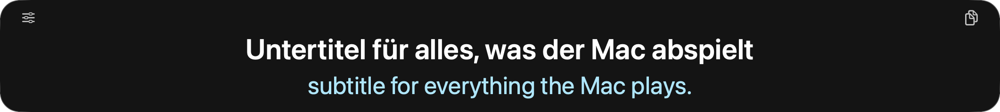
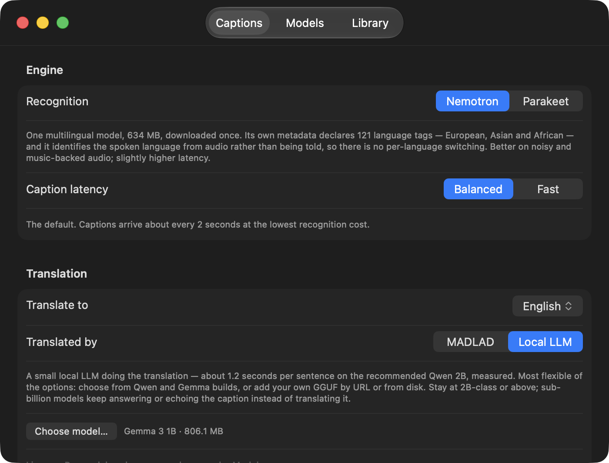
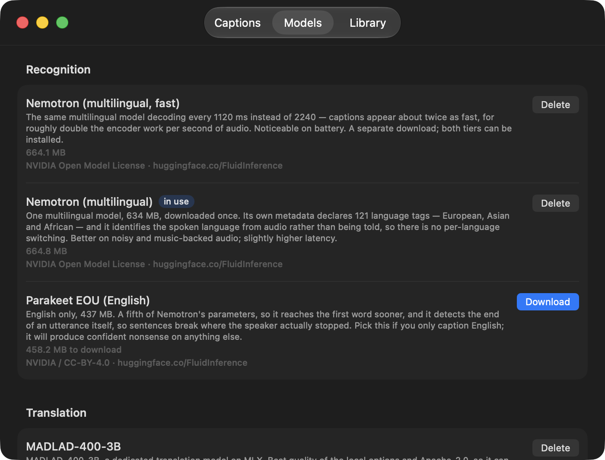
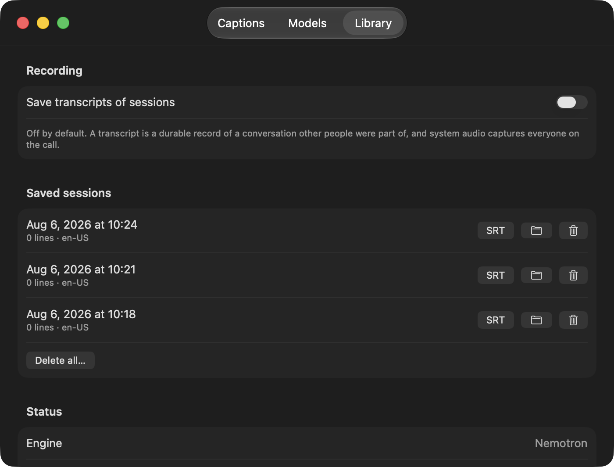

# sAiity

**Subtitles for whatever your Mac is playing.** Captured from system audio,
recognised and translated entirely on this machine — no account, no API key, and
no audio ever leaving the device. The only network traffic is a one-time model
download from huggingface.co.

<p align="center">
  
</p>

<p align="center">
  
  
  
</p>

### [Download sAiity](https://github.com/enrzh/sAiity/releases/latest)

Open the disk image and drag sAiity to Applications. It is signed, notarised and
stapled, so it opens without a Gatekeeper detour — including on a Mac with no
network. Updates arrive in the app after that, or from the menu under
**Check for Updates…**

Requires **macOS 26** on Apple Silicon. On first launch it asks for Screen
Recording permission: that is how macOS gates system audio, there is no
audio-only permission to ask for, and the microphone is never opened.

> 60 unit tests. The notes in this file try to be honest about what is verified
> and what isn't, including the parts that aren't.

---

## What is actually interesting here

**The bubble does not move.** Its width is a *setting*, not a measurement. That
sounds like a detail and is the whole trick: sizing a caption panel to its text
means it resizes and re-centres every time a word arrives, and again when the
translation lands a second later — two layout jumps per line, forever. Nothing
about the text enters the geometry. See
[`BubbleGeometry.swift`](Sources/sAiity/BubbleGeometry.swift), which is pure
arithmetic and unit-tested precisely because "it drifted left" is several steps
removed from the four lines of clamping that caused it.

**Captions commit on a pause in speech, not on a timer.** A finished sentence is
translated when the speaker stops. The alternative — flushing when a time or
length budget runs out — cuts sentences in half and hands the translator a
fragment, which is how you get confident nonsense. Silence is detected as RMS
below −45 dBFS held for 750 ms, which is a different thing from the digital
silence of a paused video, and both are handled. That threshold is the line
between a breath and a full stop: at 450 ms it fired on the pause a speaker
leaves at a comma, and a sentence with commas in it was split at every one.

**Chinese, Japanese and Korean actually work.** Sentence detection originally
required `[.!?]` followed by a space, and the rolling commit looked for the last
space in the buffer. Neither exists in a script that does not separate words, so
CJK audio was recognised perfectly and then never committed, never translated,
and never written to the transcript — until silence. Both paths now understand
`。！？` and clause breaks.

**One `process()` call is in flight, ever.** FluidAudio's streaming managers are
actors, and Swift actors are re-entrant across `await`. Two overlapping calls let
the second run the buffer compaction while the first is suspended; the first then
resumes with a stale offset and removes more elements than the array holds. That
is a real crash, twice, from two different causes — see the type documentation on
[`StreamingASRBackend.swift`](Sources/sAiity/StreamingASRBackend.swift), which
records what is now enforced and what still relies on the caller.

**It gives memory back.** MLX pools freed GPU buffers rather than returning
them, with a default ceiling near your physical RAM, so a translator that had
been released still occupied ~1.9 GB — and a second model would load on top of
it. Bounding that pool takes a session from 1.5 GB down to 196 MB the moment you
press Stop. [`MemoryPolicy.swift`](Sources/sAiity/MemoryPolicy.swift) explains
the whole failure, including the two measurement traps that made it hard to see.

## What it does

- **Captions system audio.** ScreenCaptureKit taps what the Mac is playing.
  Screen Recording permission is how macOS gates system audio — there is no
  audio-only permission, and your microphone is never touched.
- **Recognises on-device**, with two streaming engines:
  - **Nemotron 3.5 multilingual** (default, 634 MB) — one model, 121 language
    tags, identifying the spoken language from the audio itself. Two latency
    tiers, Balanced (2240 ms) and Fast (1120 ms), each its own download.
  - **Parakeet EOU** (437 MB) — English only, quicker to the first word, and it
    detects end-of-utterance itself.
- **Translates on-device**, optionally, as a second line:
  - **MADLAD-400-3B** (1.86 GB) — a dedicated translation model covering ~450
    languages, including broad Asian and African coverage.
  - **A local LLM** — curated Qwen and Gemma GGUF builds, or your own added by
    URL or picked from disk. Ollama's blobs are GGUF files and work directly.
- **Records transcripts** (off by default), exportable as SRT, Markdown or plain
  text, also from the command line.
- **Speaks German and English**, and honours Reduce Transparency and Increase
  Contrast.

## What it is not

Worth saying plainly before you clone it:

- **It runs on macOS 26 and Apple Silicon only.** That is a narrow audience,
  deliberately: the streaming recognisers are CoreML and MLX builds for Apple
  GPUs, and there is no Intel path.
- **Sentence boundaries follow pauses.** Clauses are assembled before they are
  shown or translated, but a speaker who pauses hard mid-sentence still gets a
  break there, and the recogniser's own chunk boundary decides which clause a
  word lands in. Better than it was, not exact.
- **German is not finished.** Settings, the model catalogue and the first-run
  setup are translated in full, verified by rendering every pane in German
  rather than by counting keys. The menu bar, the export formats and the
  download status lines are not, and fall back to English.
- **It is not audited**, and captions are not a transcript of record. On-device
  recognition of unclear speech is still recognition of unclear speech.

## Building

```bash
./build-app.sh            # build + sign build/sAiity.app (test hooks enabled)
./build-app.sh --install  # …and install to /Applications
./build-app.sh --notarize # Developer ID build: no test hooks, notarised, stapled
```

A bare `swift build` binary **cannot hold Screen Recording permission** — TCC
keys off a bundle identity and code signature — which is why there is an
assembled `.app` rather than a plain executable. The script bundles the vendored
`llama.framework` and the MLX metallib, and assembles `Credits.txt` from the 41
dependency licences at build time. Versions are stamped from `git describe`.

Tests need the release configuration; a plain `swift test` fails on this
toolchain's debug C targets:

```bash
swift test -c release -Xswiftc -enable-testing -Xswiftc -DSAIITY_TEST_HOOKS
```

## Command line

```bash
sAiity --version
sAiity --list
sAiity --export srt|md|txt [sessionId]
```

## Layout

| | |
|---|---|
| `Sources/sAiity/ModelRegistry.swift` | every downloadable model: paths, completeness, deletion |
| `StreamingASRBackend.swift` | the shared streaming driver — pump serialisation, the cumulative→delta committer, pause and rolling commits, subtitle timing |
| `Translators.swift`, `EngineLanguages.swift` | translation engines and per-engine language-code normalisation (MADLAD wants `zh`, never `zh-Hans`; an LLM wants an English language *name*) |
| `OverlayWindow.swift`, `BubbleGeometry.swift` | the caption bubble; geometry is pure and unit-tested |
| `MemoryPolicy.swift` | what may stay in RAM, and when it has to be given back |
| `Onboarding*.swift` | first run: permission with live status, model choice with sizes stated before download |

## Privacy

Recognition, translation and transcripts are processed and stored locally.
Transcripts are off by default and live under
`~/Library/Application Support/de.aiity.saiity/Sessions`. Model weights are
downloaded once into `…/Models`; every row in Settings → Models names its
licence and its source, and Remove All frees the lot.

See [SECURITY.md](SECURITY.md) for what counts as a finding and how to report
one.

## Contributing

Issues and pull requests welcome — [CONTRIBUTING.md](CONTRIBUTING.md) covers what
to run first. Two things about this codebase are easy to trip over, and both
were learned expensively:

1. **The bubble's width is a setting, not a measurement.** Any change that
   derives it from the text reintroduces the jitter the whole design exists to
   avoid. `BubbleGeometryTests` will fail, and that is deliberate.
2. **New settings keys must be read somewhere.** A stored-but-never-read
   appearance value looks exactly like a working feature and does nothing; five
   of the ten original `CaptionStyle` fields were in that state.
   `CaptionStyleTests` enumerates every property and stops compiling when one is
   added without being covered.

## Licence

[MIT](LICENSE) — © 2026 Xianjie Zhan.

Third-party notices are assembled into the app bundle at build time and shown in
the About window.

## Contact

[aiity.de](https://aiity.de)
